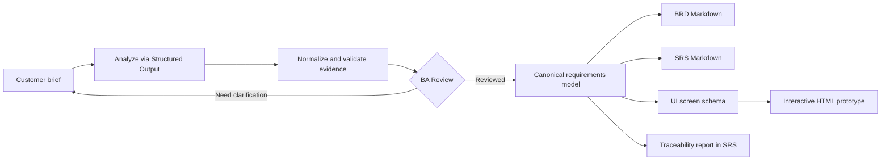

# BA Studio v3.8 — ERP Solution Intelligence

ERP projects now support current technology **separately** from candidate solutions (Odoo Community, ERPNext, Odoo Enterprise), Build/Adopt/Hybrid comparison, eight business-process discovery checklists and source/edition/version-attested Fit–Gap. The AI never treats a candidate as installed or certifies ERP capabilities automatically. Use **Phân tích → ERP Solution Strategy** after project creation; see [v3.8 ERP guide](docs/ERP_SOLUTION_INTELLIGENCE_V3_8.md), [release handoff](docs/RELEASE_HANDOFF_V3_8.md).

Quick validation: `npm run eval:erp && npm run test:serial`. Live provider and actual ERP system verification are **not** included in offline tests.

---

# BA Studio v3.6 — Multi-Project Workspaces

Each project has its own `DATA_DIR/projects/<uuid>/` with customer brief/attachments, PRD/BRD/SRS, prototype, Figma design pack/registry, workflow state, session handoff and versioned archive. SQLite remains the shared authoritative registry/queue and MUST be backed up with all workspace files. Migration is safe/copy-only for legacy Figma registry. See [Multi-project guide](docs/MULTI_PROJECT_WORKSPACES_V3_6.md).

Commands: `npm run setup`, `npm run project:migrate`, `npm run project:status`, `npm run session:bootstrap -- --project <uuid>`, `npm run eval:workspaces`, `npm run test:serial`. UI: Project → Tài liệu dự án or PRD.

---

# BA Studio v3.5 — Session Continuity & Context Handoff

New: durable engineering session/task ledger for Codex and Claude; explicit resume/new-task bootstrap, versioned evidence-backed checkpoints, artifact hash drift detection, immutable session handoff history and optional lifecycle hooks. See [Session Continuity v3.5](docs/SESSION_CONTINUITY_V3_5.md).

On entry: `npm run setup` then `npm run session:bootstrap`. Every milestone: `npm run session:checkpoint -- --file checkpoint.json`; before switching sessions: `npm run session:handoff -- --task <uuid>`. Run `npm run eval:continuity` and `npm run test:serial`.

# BA Studio v3.4 — Production Validation & Quality Intelligence

**v3.4 update (2026-10-13):** Deterministic BRD/SRS quality rubric + opt-in workflow quality gate, transaction-backed quality change history, request-scoped AI usage/cost telemetry, configurable labeled-gold benchmark, Figma MCP read-only contract probes, and UI Quality Intelligence. No live provider or Figma MCP session was certified by offline tests. See [Architecture v3.4](docs/ARCHITECTURE_V3_4.md) and [v3.4 changelog](docs/CHANGELOG_V3_4.md).

Run `npm run setup && npm test && npm run eval:v34 && npm run eval:quality && npm run eval:figma-contract`. `BA_QUALITY_ENFORCE` defaults to false so v3.3 runs continue. Use `--live` with provider credentials / Figma MCP only in an authorized environment. **A quality proxy PASS is not customer acceptance.**

# BA Studio v3.3 — Production Workflow Engine

**v3.3 upgrade (2026-10-13):** SQLite WAL is the project source of truth, durable job queue with cross-process lease fencing, human reviewer audit, nonce-bound Figma MCP read-back and BA visual QA gate. Requires **Node.js >=22.13**. Retains single-agent workflow and the v3.2 API. See **[Production Architecture v3.3](docs/ARCHITECTURE_V3_3.md)** and **[v3.3 changelog](docs/CHANGELOG_V3_3.md)**.

Run `npm run setup && npm test && npm run setup:start` (Node >=22.13). For a separate worker, start API with `BA_WORKER_ENABLED=false npm start` and worker with `npm run worker` using the same host-local `DATA_DIR`. Back up with `npm run backup` **plus full `data/projects/`**; preserve legacy `.workflow-artifacts` and `.figma-registry` while migrating. Operator-reported Figma read-back is **not** an independent Figma attestation or customer sign-off.

# BA Studio v3.2 — Intelligent BA Workflow → BRD / SRS / Figma Design

A **local-first MVP** for a Business Analyst. Input customer requirements, detect ambiguities, review extracted requirements, and export a traceable BRD, SRS, and interactive click-through prototype.

**Stack (v3.4):** Node.js >=22.13 (built-in HTTP + Fetch, ESM), Codex CLI or OpenAI Responses API with JSON Schema in LIVE mode; vanilla HTML/CSS/JavaScript. **No npm install needed** for the web server.

## New in v3.2: Intelligent BA Workflow

Create a project to start **Brainstorming → Elicitation → Gap Analysis → Clarification → BA Review → BRD/SRS + Prototype → Figma Design Pack**. The browser opens a new Workflow tab with live stage status, persistent checkpoints, unresolved questions and human approval gates. v3.3 adds a durable background queue worker; a stage failure or killed process can be retried from its persisted checkpoint when a worker is running. Manual API operations from v3.1 remain available.

High-priority gaps halt automatic execution. You can supply a sourced customer answer or accept every currently open high-risk item with a written BA rationale; that still does **not** constitute customer approval. An explicit BA Review is always required before deliverables. The final workflow stage is **AWAITING_FIGMA**: locally generated pack is ready, not a claim of live Figma publication. Connect the Figma MCP plugin and run `scripts/figma-design.mjs --publish` manually; the UI can subsequently reconcile its reported verified-node registry. Human visual inspection remains mandatory.

- [Full v3.2 architecture, API, guardrails, trade-offs](docs/ARCHITECTURE_V3_2.md)
- [v3.2 changelog](docs/CHANGELOG_V3_2.md)
- `npm run eval:workflow` — workflow integration/crash-resume checks
- `npm run eval:semantic` — five-case **synthetic keyword proxy** benchmark; not certified semantic accuracy

## Quick start

For step-by-step environment setup (Node.js, demo/API modes, Codex CLI and Superpowers), see **[setup.md](setup.md)**.

```bash
cp .env.example .env
npm start
# Open http://127.0.0.1:3478
```

The default is `DEMO_MODE=true`. Click **Nạp ví dụ demo**, then **Tạo dự án & chạy workflow**. Demo uses preconfigured, deterministic requirements ONLY for the bundled sample, not AI. Other briefs get clarification questions and an empty requirements list instead of invented features.

For AI-powered analysis, edit `.env`:

```dotenv
DEMO_MODE=false
OPENAI_API_KEY=sk-...
OPENAI_MODEL=gpt-4.1-mini
PORT=3478
HOST=127.0.0.1
```

Run `npm start` again. Your API key stays on the Node server and is never embedded in the UI. With `AI_PROVIDER=openai`, the server calls OpenAI Responses API with strict JSON Schema. With `AI_PROVIDER=codex`, the server calls a locally logged-in Codex CLI without `OPENAI_API_KEY`; see `setup.md`.


## v3 improvements (2026-10-13)

- `AI_PROVIDER=codex` calls logged-in Codex CLI non-interactively (`--output-schema`, `--output-last-message`, isolated temporary working directory, timeout, JSON shape validation). `OPENAI_API_KEY` is not required in Codex mode.
- Conservative immutable requirement IDs across re-analysis; snapshots in transactional SQLite `project_versions` (legacy filesystem history is no longer authoritative) and change summaries in `changeLog`; prior prototype screens can retain their IDs after reordering.
- Separate customer brief, BA notes and sourced customer replies; a BA note alone never promotes a requirement to `confirmed`. Questions can be marked answered-pending-BA-review, not automatically approved.
- Figma publish plan + per-file registry (fingerprints); skip unchanged screens and record only agent-reported verified Node IDs after schema validation. **Not validated live with Figma yet.**
- API security: localhost-only by default; external bind requires `BA_STUDIO_TOKEN` (min. 32 characters). One local operator; no multi-tenant/RBAC.
- Concurrency guard and optional `If-Match` project version check to prevent overlapping writes from the same server process.

See [setup.md](setup.md) for complete current instructions and [`docs/figma-handoff.md`](docs/figma-handoff.md) for Figma limits.

## Capabilities

| Step | MVP behavior | Output |
|---|---|---|
| Intake | Paste a customer brief, import `.txt` / `.md` / `.json` (text), save locally | Project + original brief + provenance sources |
| Analyze | LLM extracts business context, stakeholders, requirements, business rules, risks, assumptions, open questions | Normalized requirements with IDs |
| Evidence validation | Explicit requirements must cite an exact extract from the brief; failed evidence becomes an assumption | Confirmed / assumption flags |
| Refine | Add separately sourced BA notes/customer replies and re-analyze; prior review/prototype invalidated | Updated version and snapshot |
| BA Review | Explicit human acknowledgement with notes; unresolved issues remain visible | Review record |
| Document | Deterministic generation from one normalized requirements model | Downloadable `BRD.md` and `SRS.md` |
| Prototype | AI designs JSON-schema wireframes; UI renders safely with no generated executable JavaScript | Click-through UI + downloadable `prototype.html` |
| Traceability | Stable FR IDs are reused between documents/versions and screen metadata | FR → goal → prototype mapping in SRS |
| Export | JSON, Markdown and portable single-file prototype | `/api/projects/:id/export/...` |

## Workflow



### Design principles

1. **Single source of truth:** `analysis` is the canonical requirements object; documents are rendered deterministically from it.
2. **Provenance:** only requirements with matching evidence text can receive `confirmed` status. This checks evidence quoting, **not** business correctness or customer approval.
3. **Human-in-the-loop:** generating deliverables requires a BA review record. Review is **not** customer sign-off.
4. **No fabricated acceptance:** unknown flow elements remain questions/assumptions; documents are explicitly labelled draft.
5. **Prototype as safe data:** model produces screen JSON only; local renderer creates DOM and navigation, not arbitrary AI-generated scripts.
6. **Revision discipline:** re-analysis invalidates previous review/prototype but preserves prior project snapshots under `data/.history/`; FR/NFR/BR/Q and prototype screen IDs use conservative stable matching. History is local-file snapshots, not a tamper-proof audit log.

## API

| Method | Route | Purpose |
|---|---|---|
| GET | `/api/status` | AI / demo mode |
| GET | `/api/projects` | Project list |
| POST | `/api/projects` | Create `{title, brief}` |
| GET | `/api/projects/:id` | Load project |
| POST | `/api/projects/:id/analyze` | Extract requirements |
| POST | `/api/projects/:id/clarify` | `{clarifications}` then reanalyze |
| POST | `/api/projects/:id/review` | `{approved:true, notes}` |
| POST | `/api/projects/:id/generate` | Generate prototype after review |
| GET | `/api/projects/:id/export/brd.md` | BRD download |
| GET | `/api/projects/:id/export/srs.md` | SRS download |
| GET | `/api/projects/:id/export/prototype.html` | Single-file interactive prototype |
| GET | `/api/projects/:id/export/json` | Requirements and prototype JSON |

Project data is stored under `data/projects/<uuid>/` with authoritative SQLite in `data/ba-studio.sqlite`, on the **local computer**. Do not commit it to Git. The server listens on `127.0.0.1` by default.

## Validation

```bash
npm test
```

Tests cover quote provenance, stable requirement ID normalization, screen navigation mapping, HTML escaping, and the complete API state machine (create → analyze → review → generate → export → clarify). Live OpenAI calls are not executed by tests and require an API key.

## Boundaries / next stages

- **Prototype:** MVP exports a click-through HTML wireframe, **not a native Figma file** and not a production application. Buttons without a screen destination display a demo notice; input data is not submitted.
- **Requirements quality:** brief interpretation and generated content **must be checked by a BA**. The evidence check alone cannot detect contradictory statements or guarantee accuracy.
- **Document formats:** MVP exports Markdown, not DOCX/PDF. Convert via Pandoc or add dedicated renderer in the next iteration.
- **Inputs:** PDF/DOCX/meeting transcripts are not yet parsed; current upload supports text-based files up to 300 KB. For large files, add OCR or parsers with chunking and source citations.
- **Security:** This is a **single-user local MVP** with no sign-in or multi-tenant access control. Do not expose the server publicly. Before production, add authentication, role-based access, encrypted storage, audit log, retention controls, rate limiting, and privacy review. LIVE mode sends customer brief + review context to OpenAI API, so obtain permission for confidential material.
- **Maturity:** No actual BA/client sign-off workflow, Figma synchronization, Jira import/export, change-impact graph, RAG, or end-to-end requirement evaluation yet.

## Suggested production extension

- Ingestion agent: PDF/DOCX/email/meeting notes + source spans and contradiction detection.
- Discovery agent: interview questions, gap scoring, stakeholder matrix and business process mapping.
- Specification agent: typed canonical object and requirement versioning, glossary, use cases, user stories, acceptance tests, NFR test conditions.
- UX agent: sitemap, user flow, design-system-constrained Figma/React prototypes and traceability.
- Independent reviewer: completeness, testability, consistency, ambiguity, orphaned requirements and change impact.
- Workflow: review gates at business requirements and prototype stages, client approval, baseline + diff.

## Source files

- `src/openai.js` — prompt and API integration
- `src/schemas.js` — machine-enforced AI output schemas
- `src/normalize.js` — provenance/ID/screen validation
- `src/docs.js` — deterministic BRD/SRS renderers
- `src/export.js` — standalone safe HTML prototype
- `src/server.js` — HTTP server, state machine and persistence
- `public/` — web application UI
- `tests/` — logic + end-to-end tests

## Bundled sample outputs

`examples/generated/` contains an illustrative `BRD.md`, `SRS.md`, `prototype.html`, and `analysis.json` built from the sample brief. They are **demo artifacts**, not customer-approved deliverables. The HTML prototype can be opened directly in a browser, even without running the server.

## BA Skills on Superpowers + BABOK v3 (new)

BA Studio now includes **seven portable BA agent skills** in `skills/ba-*/SKILL.md`, a BABOK v3 task mapping (`docs/babok-mapping.md`), deterministic quality checks, a customer clarification questionnaire and a versioned canonical export.

```text
Customer brief
  → ba-eliciting-requirements     (BABOK 4.1–4.5)
  → ba-normalizing-requirements   (BABOK 7.1 / 7.4)
  → ba-detecting-gaps             (BABOK 7.2)
  → ba-clarifying-requirements    (iterate when new answers arrive)
  → ba-verifying-requirements     (BABOK 7.2 / 7.3)
  → ba-generating-deliverables    (BRD + SRS + prototype)
```

### Install BA Skills in an agent harness

Superpowers **must be installed separately** in Codex, Claude Code or another compatible harness. This package does not contain, redistribute, or execute the Superpowers plugin itself. Install Superpowers from https://github.com/obra/superpowers then copy these BA skill directories into the agent's skill search path:

```bash
# In the unzipped project root — Codex / compatible agents
mkdir -p ~/.agents/skills
cp -R skills/ba-* ~/.agents/skills/
# Restart the agent session to refresh discovery.
```

Skills can be invoked by name or discovered by their `description` frontmatter, e.g. **"Use ba-orchestrating-analysis to analyze this customer brief, identify BABOK gaps, ask clarification questions and emit a canonical model."** `AGENTS.md` explains how to combine the domain skills with Superpowers process skills. For Claude Code, put them in its skills directory (e.g. `~/.claude/skills/`) instead.

**What executes in the Node app?** In LIVE mode the application loads BA Skill guidance into Structured Output prompts; `src/ba-quality.js` independently performs deterministic gap checks. This is a **single AI call plus local guards**, not a multi-agent runtime or a tool call to the installed ChatGPT Superpowers plugin. Use a Superpowers-enabled agent harness for the fuller agent-driven elicitation workflow.

### New exports

| Export | Endpoint | Requires BA review? |
|---|---|---|
| Clarification questionnaire | `/api/projects/:id/export/questions.md` | No — questions come before review |
| Versioned canonical model | `/api/projects/:id/export/canonical.json` | No |
| BRD / SRS drafts | existing `/export/brd.md`, `/export/srs.md` | Yes |
| Click-through prototype | existing `/export/prototype.html` | Yes + generate |

Canonical contract: `schemas/ba-canonical-v1.schema.json` (`ba.canonical.v1`). It contains `business`, `requirements` (FR, NFR, rules), `elicitation`, `quality`, `review`, `prototype`, and `traceability`. Each FR/NFR links to its goal ID and screen IDs where known. Both documents now include the exact same BABOK Quality Gate report, and the UI displays it before BA review.

Validate an exported canonical file offline:

```bash
node scripts/validate-canonical.mjs path/to/canonical.json
```

The script performs identity/reference/evidence checks; it is **not** a full JSON Schema validator. For complete schema validation, use a Draft 2020-12 JSON Schema validator. For LIVE quality, evaluate agent outputs with real sample briefs: sparse, contradictory, changed and privacy-sensitive requests.

### Governance and current limitations

- A matching `sourceEvidence` excerpt proves a phrase exists in a recorded customer-attributed source (initial brief or sourced customer reply); BA notes alone do not confer confirmation. It is **not customer confirmation**. `review.customerApproved` is `false` and `baselineStatus` is `NOT_BASELINED` until a real sign-off workflow is built.
- The quality engine checks mechanically observable fields, **not semantic contradictions** or true business value. An all-clear is not IIBA verification or customer approval.
- Quality may include additional generated questions beyond the original AI questions. A missing NFR in the input is **not automatically a requirement**; ask first.
- v3 performs conservative stable matching for FR/NFR/BR/Q and screens across iterations; ambiguous renamed requirements can still require manual identity reconciliation. IDs are never proof of semantic equivalence.
- User-entered clarification notes are attributed to the local BA workflow, not automatically to a customer. Record customer-approved evidence independently.
- BABOK is a trademark of IIBA; this is an original inspired workflow and is **not** official IIBA software or a redistribution of the BABOK Guide.

## Figma prototype from BRD / SRS (UI UX Pro Max + TalkToFigma MCP)

The **optional Figma handoff** turns reviewed BRD/SRS and `ba.canonical.v1` into an editable Figma design task. It uses:

- [nextlevelbuilder/ui-ux-pro-max-skill](https://github.com/nextlevelbuilder/ui-ux-pro-max-skill) for design-system, typography, layout and accessibility guidance.
- [grab/cursor-talk-to-figma-mcp](https://github.com/grab/cursor-talk-to-figma-mcp) for Figma frame/text/shape creation and verification via a Codex CLI agent.
- `skills/ba-designing-figma/SKILL.md` to preserve FR→screen traceability, human review, and DRAFT assumptions.

**Web UI:** after **BA Review**, open BRD/SRS and download **Figma Design Brief** and **Figma Manifest**. If you have already generated an HTML prototype, its screens and components are reused; otherwise the handoff creates conservative screen candidates directly from functional requirements. No Figma file is modified by web exports.

**Local operator flow:**

```bash
# From BA Studio root, with an existing project ID from the UI:
node scripts/figma-design.mjs --project YOUR_PROJECT_UUID --platform web
# This creates the pack inside .figma-exports/

# Only after setting up Codex + UI UX Pro Max + TalkToFigma MCP, starting
# the WebSocket service, opening a Figma document, and joining plugin channel:
node scripts/figma-design.mjs --project YOUR_PROJECT_UUID \
  --platform web --publish --channel YOUR_FIGMA_CHANNEL \
  --figma-file YOUR_FIGMA_FILE_KEY
```

For mobile, pass `--platform mobile`. See [setup.md](setup.md) for prerequisites. The operator must explicitly trigger `--publish`; the app itself never silently launches an external process. The structured Codex report is saved as `figma-run-report.json` beside the pack, and a verified-by-agent registry is written under `data/.figma-registry/` only if it validates. Verify the Figma document and node IDs manually. Figma MCP's basic drawing tools **do not automatically guarantee native clickable prototype interactions**.

The pipeline is **not yet end-to-end tested against a real Figma session**. Offline handoff and API tests are included in `npm test`. Codex CLI can run as the web analysis provider with `DEMO_MODE=false` and `AI_PROVIDER=codex`, or independently for Figma publishing. Neither live Codex nor live Figma has been verified in this environment; automated tests use mock CLI processes.

## v3.1 hardened workflow (2026-10-13)

v3.1 is a backwards-compatible hardening iteration of v3: it fixes the single-process project mutation lock race, validates bounded provider outputs uniformly, detects duplicate/reused Figma node reports, and adds repeatable environment/guardrail checks. See [v3.1 architecture](docs/ARCHITECTURE_V3_1.md) and [changes](docs/CHANGELOG_V3_1.md).

```bash
npm run setup                  # creates .env only if absent, preflights environment
npm run setup:start            # also starts local server in foreground
npm run setup -- --install-skills=both   # optional Codex + Claude Code BA skill installation
npm run doctor                 # provider/environment preflight
npm run doctor:figma           # optional tooling check, not a live Figma session verification
npm test                       # regressions
npm run eval                   # six offline guardrail scenarios; not an LLM quality benchmark
```

`REQUIRE_IF_MATCH=true` (optional, recommended for APIs accessed by multiple clients) requires project-version headers on mutating project requests. The supplied web UI already provides them. Concurrent writes are serialized inside **one** Node process; shared data directories across multiple Node processes are still unsupported. Figma `--force` performs manual recovery by creating new frames and is **not** automatic sync or proof of actual MCP file identity.

**Provider support:** this application executes demo/Codex CLI/OpenAI API; Claude Code users can reuse BA Skills but there is no integrated Claude API/CLI provider. MCP is used for Figma tools, not as an alternative AI provider.

## v3.4 Live Acceptance Validation (human-reviewed, opt-in)

`docs/LIVE_ACCEPTANCE_V3_4.md` describes corpus prerequisites, an explicit real-provider run, two BA reviewer judgments + adjudication, read-only Figma MCP/REST cross-check, BA visual QA, and fail-closed acceptance report. Commands: `npm run eval:live-tests`, `npm run eval:live-acceptance -- --preflight --corpus ...`, `--run`, `--score`, and `npm run eval:figma-crosscheck`. Do **not** use the synthetic template as production acceptance data. Nothing runs live merely by starting the server.


## v3.7: Recommendation-Assisted Clarification

Gap Analysis can now propose 1–3 stack-grounded technical alternatives (demo, OpenAI or Codex). Operators configure project tech stack first; proposals remain drafts until the BA/customer selects an exact option with decision rationale and evidence. Selected answers are persisted and versioned per project, and downstream PRD/SRS require re-analysis and BA Review. See [v3.7 implementation guide](docs/RECOMMENDATION_ASSISTED_CLARIFICATION_V3_7.md).
