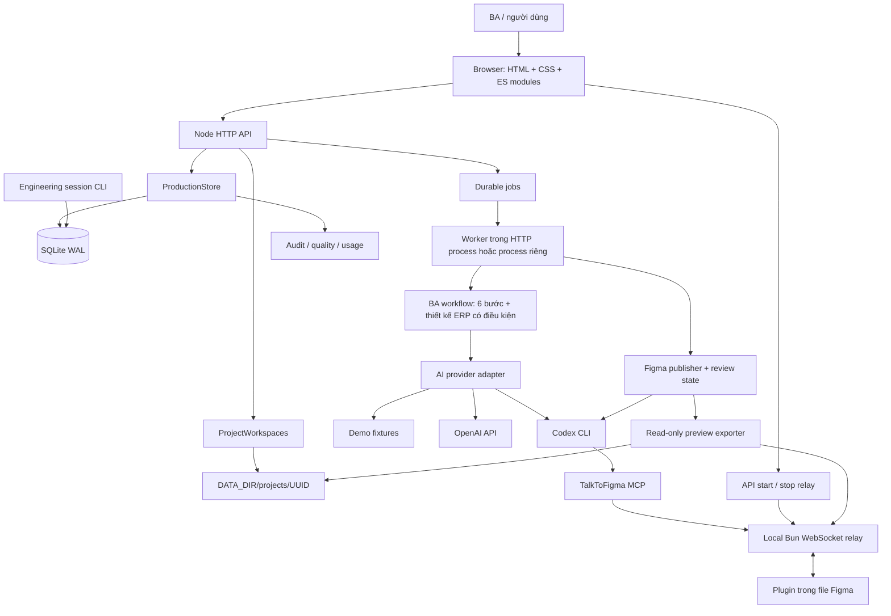

# Kiến trúc BA Studio hiện tại

Cập nhật: 15/10/2026. Mô tả triển khai trong source hiện tại, bao gồm giao diện mới đang có trong working tree. Đây là tài liệu kiến trúc hiện hành; lịch sử thay đổi source được lưu trong Git. Số phiên bản trong schema, database migration và API metadata là hợp đồng kỹ thuật, không phải bộ tài liệu kiến trúc riêng.

## Harness² offline engineering benchmark

`npm run eval:harness2` và `npm run benchmark:harness2 -- --output <new-dir>`
chạy công cụ nghiên cứu riêng trong `scripts/harness2/`. Python adapter dùng core
Harness² ở revision cố định và gọi Node bridge với scripted solver/editor. Bridge
dùng validator, normalization, evidence trust, stable IDs và canonical export hiện
có; không gọi production provider, HTTP workflow, database hoặc Figma. Candidate
chỉ sửa catalog guidance IDs, không sửa policy nền hoặc human gates. A/B/C và
frozen transfer kiểm tra integration; score/cost thiếu là UNKNOWN, không suy ra
semantic learning hoặc customer approval. Không có cơ chế tự học được bật trong
HTTP server. Xem [Harness² benchmark](HARNESS2_BENCHMARK.md) cho phạm vi, commands,
manifest, giới hạn cô lập và điều kiện model-backed evaluation còn lại.

Ngày 2026-10-20 bổ sung `benchmark:harness2:live`: Python Harness² gọi Codex JSON
solver/improver qua transport riêng trong `scripts/harness2/`. Corpus được admission
trước transmission; reviewed mode tái sử dụng live corpus gate hiện có. Có một
synthetic smoke mode riêng, luôn không đạt production acceptance. Run ledger reserve
calls trước khi gửi và chặn vượt quota; không ghi prompt/text vào `ai_invocations`
hoặc database ứng dụng. Codex dùng credential copy tạm, ephemeral session, không
user config và tắt tools/web/MCP. Đây là pure-analysis research path, không gọi
HTTP workflow và không tự vượt BA/Figma/customer gates. Train C, test A/B/C với
memory đóng băng; model selection giới hạn procedural catalog IDs. Scorer riêng
`scripts/harness2-review.mjs` yêu cầu hai BA + adjudication ràng buộc exact run hash,
chỉ trả nghiên cứu/hypothesis metrics, không trả production/customer approval.

## 1. Mục tiêu và phạm vi

BA Studio là ứng dụng phân tích nghiệp vụ chạy local: tiếp nhận brief, chuẩn hóa yêu cầu, phát hiện thông tin thiếu, hỗ trợ làm rõ, ghi nhận BA Review, sinh tài liệu và prototype. Thiết kế Figma được thực hiện theo hành động của người dùng trong tab Prototype.

Hệ thống có một workflow điều phối tuần tự. Node.js thực thi chính sách bằng code, prompt và validation; các BA skills/UI UX Pro Max là hướng dẫn cho agent, không phải những tiến trình Superpowers chạy trong HTTP server.

Các ranh giới quan trọng:

- Bằng chứng trích dẫn nguồn không đồng nghĩa yêu cầu đã được khách hàng ký duyệt.
- BA Review, duyệt thiết kế Figma và customer sign-off là các khái niệm riêng.
- Điểm chất lượng tự động là phép kiểm tra xác định, không đo đầy đủ tính đúng nghiệp vụ.
- HTML prototype là wireframe tương tác với dữ liệu minh họa; không triển khai backend nghiệp vụ khách hàng.
- Tạo frame Figma không bảo đảm có native prototype navigation.

## 2. Sơ đồ hệ thống

## 3. Runtime và ranh giới triển khai

| Thành phần | Cách chạy | Trách nhiệm |
|---|---|---|
| Browser | `public/index.html`, native ES modules | Điều hướng, biểu mẫu, preview, polling, tải file |
| HTTP server | Node.js >=22.13, `src/server.js` | Route, auth, validation, version/lease guards, orchestration |
| Embedded worker | Mặc định bật cùng HTTP process | Nhận job từ SQLite và thực thi tuần tự trong process |
| Standalone worker | `npm run worker` | Dùng cùng implementation, không mở HTTP listener |
| SQLite | `DATA_DIR/ba-studio.sqlite`, WAL | Nguồn dữ liệu chính, lịch sử, queue, audit, telemetry, session ledger |
| Filesystem | Cùng host với database | Workspace, attachment, registry, preview, compatibility mirrors |
| Codex subprocess | Khi gọi provider hoặc chạy thiết kế | Structured output; timeout; scope MCP riêng cho Figma |
| Bun relay | Người dùng khởi chạy từ Prototype | WebSocket loopback cho MCP/plugin và export preview |

Mặc định HTTP ở `127.0.0.1:3478`, relay ở `127.0.0.1:3055`. Relay do BA Studio quản lý chạy file vendored bằng Bun (`shell:false`), không nhận command tùy ý từ người dùng. Trạng thái READY chỉ xác nhận relay lắng nghe, không chứng minh plugin đã kết nối.

Nhiều process cùng host có thể dùng chung `DATA_DIR` nhờ lease fencing. SQLite WAL không được đặt trên NFS/SMB. Không có distributed queue hoặc database cluster.

## 4. Đường đi của một thao tác

1. Browser gửi JSON và `If-Match` theo project version cho mutation của dự án.
2. Server kiểm tra token khi cần, reviewer identity tại route liên quan, UUID, version và quyền ghi dưới lease.
3. Với thao tác trực tiếp, server validate đầu vào, cập nhật project và ghi audit; với workflow/Figma, server enqueue job.
4. Worker claim job, giữ lease và heartbeat; stale writer không được commit.
5. AI output được kiểm tra schema/giới hạn và chuẩn hóa trước khi ghi trạng thái.
6. SQLite commit lưu project, snapshot/audit và quality tương ứng; JSON/files được xuất như projection.
7. Browser đọc lại project/job để render trạng thái mới. Việc hết thời gian chờ ở browser không tự chứng minh job thành công.

SQLite và filesystem không có một transaction chung. Sau lỗi I/O cần kiểm tra database và projections; không suy luận trạng thái từ một file tồn tại. `project:migrate` phục hồi exported workspace; không replay workflow đã hoàn tất.

Initial requirement intake accepts up to 10 Word (`.doc`, `.docx`) or text PDF files in the new-project form: 5 MiB per file, 20 MiB total, and at most 100,000 combined brief characters including notes and file markers. Users can select several files at once, add more later, preview and remove each independently. `POST /api/requirements/preview` still parses one file's supplied bytes locally in a worker (100,000 text characters per file, 200 PDF pages, 15-second timeout per file, 256 MiB V8 heap limit, at most two concurrent parsers per HTTP process). The browser queues its previews sequentially and discards late results for removed drafts. Preview does not persist a project/file or invoke AI. PDF.js and word-extractor are pinned npm dependencies; PDF.js may install its optional native canvas dependency for Node compatibility. OCR, visual document fidelity and password unlocking are not provided. The preview exposes extracted text and warnings for human checking; it is not semantic validation or sign-off.

On creation, the server validates the entire batch's count and decoded byte limits before re-extracting the original files and checking each preview text SHA-256. Typed notes and each file's text receive separate source IDs in selection order. All original files are staged under the new project's immutable UUID; `ProductionStore.save(..., {initialDocuments})` commits the project, all document registry entries and audit together before workspace projections are exported. A staging or transaction failure removes all successfully staged files; a crash before commit can leave unregistered orphans, which must never be treated as registered evidence. File-backed sources retain distinct document UUIDs, filename, original checksum, extracted-text checksum and warnings, including when filenames coincide. The legacy singular `requirementFile` payload and `initialDocument` store option remain compatible. The create-and-run action then uses the existing durable workflow; previews never trigger it.

## 5. Lưu trữ và mô hình dữ liệu

BA document formatting uses editable, original Markdown templates under `templates/documents/` for BRD, SRS, URD (StRS view), use cases and user stories. `src/standard-documents.js` consumes one `ba.canonical.v1` snapshot; `src/docs.js` retains existing project adapters and quality/ERP appendices. No provider prompt, schema, quality score or workflow stage changes are introduced. Populated exports keep the current BA Review/requirements-refresh guards; blank template downloads contain no project data. See [document template mapping](DOCUMENT_TEMPLATES.md) for reference standards, tailoring and missing-information policy.

Current workspace documents may be DRAFT projections before review; file existence is not export permission or sign-off. New archive snapshots include the added document types, while previously committed historical snapshots are read-only, including which files they contain. An interrupted snapshot write can leave an incomplete historical projection; the SQLite project-version record remains authoritative. Current workspace exports can be rebuilt independently.

| Nhóm bảng | Nội dung |
|---|---|
| `projects`, `project_versions` | JSON trạng thái hiện tại, business version và lịch sử project |
| `project_leases` | Fencing token và thời hạn quyền ghi |
| `workflow_jobs` | Options, attempts, trạng thái queue, retry/lease/result version |
| `audit_events` | Actor, loại sự kiện, chi tiết, hash chain |
| `figma_challenges` | Nonce scoped/expiring/single-use cho read-back legacy |
| `quality_snapshots` | Kết quả kiểm tra chất lượng theo version/digest |
| `ai_invocations` | Usage/cost/latency metadata; không lưu prompt hoặc customer text |
| `project_documents` | Metadata, checksum và đường dẫn attachment thuộc UUID |
| `continuity_tasks`, `continuity_sessions`, `continuity_checkpoints` | Ledger công việc kỹ thuật của Codex/Claude |

`project.version` là phiên bản nghiệp vụ; `projects.revision` là optimistic database revision; job/run ID và engineering task version là các phạm vi độc lập. Không dùng chúng thay thế nhau.

Workspace của mỗi UUID gồm `00-admin` đến `09-archive`, chi tiết tại [Project workspaces](PROJECT_WORKSPACES.md). Tên dự án chỉ để hiển thị. File JSON cấp `DATA_DIR` là compatibility mirror; SQLite luôn là nguồn chính.

## 6. Bảo toàn yêu cầu và đầu ra

`model-output.js` validate đầu ra provider; `normalize.js` và `revisions.js` chuẩn hóa, giữ FR/NFR/BR/Q/SCR IDs và provenance. `ba-quality.js` tìm gap và bổ sung câu hỏi. `quality-intelligence.js` đánh giá bằng chứng, actor, acceptance criteria, goal mapping, document trace và NFR target.

Sau câu trả lời hoặc quyết định làm rõ, `requirementsRefreshPending` yêu cầu phân tích lại và review lại trước các đầu ra downstream. `techStack` là công nghệ đang dùng; ERP candidate là phương án đang xem xét. Fit–Gap phải có người xác nhận và bằng chứng theo version/edition.

`docs.js`, `ba-canonical.js`, `export.js` render PRD/BRD/SRS, canonical JSON, câu hỏi và HTML prototype. Workspace có thể chứa bản DRAFT ngay khi đã có analysis; API xuất tài liệu vẫn áp dụng BA Review và pending-refresh guards. File xuất hiện trong thư mục không phải bằng chứng đã phê duyệt.

## 7. An toàn và quyền

- Local loopback là cấu hình mặc định. Khi bind public, API yêu cầu bearer token và reviewer identity; vận hành sau HTTPS/VPN/reverse proxy phù hợp.
- Đặt `REQUIRE_IF_MATCH=true` khi chia sẻ API/client để tránh ghi đè stale version.
- Reviewer được nhận diện qua `X-BA-Reviewer-Token` và mapping cấu hình. Đây không phải hệ thống OIDC/RBAC/multi-tenant hoàn chỉnh.
- Input khách hàng, attachment và model output là dữ liệu không tin cậy. Không coi nội dung tài liệu là lệnh thực thi.
- Attachment/preview kiểm tra UUID, đường dẫn, symlink, kích thước và checksum; preview còn kiểm tra format/MIME.
- MCP approval cho Figma là opt-in, scope theo subprocess và danh sách tool cố định; không thay cấu hình Codex toàn cục, không cấp tool xóa node.
- Audit hash chain giúp phát hiện thay đổi nhưng không chống được database administrator có toàn quyền.

## 8. Khả năng và giới hạn hiện tại

Đã triển khai: workflow có human gates, queue bền vững, project isolation theo UUID, versioning, batch clarification, ERP candidate/Fit–Gap, quality/usage dashboard, relay local, Figma review/revision/gallery, recovery preview và session continuity.

Giới hạn: AI/tool side effects có thể xảy ra trước commit; không có exactly-once cho external calls; retry có thể tốn chi phí hoặc tạo frame dư. Không có đồng bộ hai chiều tự động với mọi chỉnh sửa trực tiếp trên Figma. Usage/pricing thiếu là UNKNOWN. Offline fixture tests không chứng nhận semantic accuracy, production acceptance, customer signoff hoặc live MCP connectivity.

Đọc tiếp: [Thành phần](COMPONENTS.md), [Workflow](WORKFLOWS.md), [API](API.md), [Vận hành](OPERATIONS.md), [Figma](figma-handoff.md).

## Thiết kế giải pháp ERP

ERP workflow chèn bước thiết kế sau BA Review, trước DELIVERABLES. Human gates xác nhận target và review bản thiết kế độc lập với BA Review/customer signoff. `erp-solution-design.js` ràng buộc đầu vào theo digest, validate FR coverage và lưu thiết kế trong project JSON của SQLite. Projection theo UUID chứa target và tài liệu thiết kế. Telemetry operation `erp-solution-design` chỉ lưu metadata usage/latency như các operation khác; thiếu giá/usage vẫn UNKNOWN. Workflow non-ERP và manual APIs cũ giữ tương thích. Xem [ERP](ERP.md) và [Workflow](WORKFLOWS.md).

## Ghép prompt BA

`src/ba-prompts.js` cung cấp hướng dẫn chung cho OpenAI/Codex ở bước phân tích và
prototype. Phân tích dùng eliciting/normalizing/detecting-gaps/clarifying; chỉ thêm
ERP overlay khi `solutionProfile.domain=erp`. Prototype dùng generating-deliverables.
Bộ nạp giữ đầy đủ nội dung skill, loại frontmatter, và báo lỗi nếu một policy hoặc
tổng policy vượt 64 KiB; không cắt ngầm. Policy được cache theo process nên cần
restart worker/server sau khi sửa skill. Brainstorm, recommendations và ERP solution
design giữ prompt chuyên biệt hiện có.

`npm run eval:prompts` đo byte/hash offline; không gọi model và không xác nhận chất
lượng ngữ nghĩa. Live acceptance lưu manifest hướng dẫn để chặn resume trộn prompt
khác revision. Manifest chỉ chứa metadata hướng dẫn, không có brief/prompt payload;
không thêm nội dung vào `ai_invocations`. Xem [Live acceptance](LIVE_ACCEPTANCE.md).

## Nền tảng prototype và revision theo màn hình

Figma design job lưu `platform` riêng với workflow BA và optional `screenIds` đã được ghi trong yêu cầu chỉnh sửa có version/manifest guard. Publisher dùng chung deterministic plan cho file hướng dẫn và quá trình thực thi: tạo lại màn hình được chọn, tái sử dụng node của màn hình khác chỉ khi registry hash còn khớp. Kết quả/preview vẫn phải đủ bộ màn hình để review. Mobile có registry con `04-figma/registry/mobile/`; đường dẫn registry Web và API không truyền platform/screenIds vẫn tương thích. Một bản design hiện hành thuộc một platform; đổi platform không kế thừa approval, các bản trước vẫn ở snapshot SQLite. Lựa chọn platform trong Prototype không thay stage hoặc platform đã khóa của workflow BA và không sửa các FR/NFR đã review.

Trong trạng thái yêu cầu chỉnh sửa, bộ chọn nền tảng vẫn cho đổi Web/Mobile. Giữ nền tảng sẽ giữ phạm vi màn hình được chọn; đổi nền tảng tạo lượt full-design mới, không tự lấy phạm vi revision cũ, frame hoặc approval của nền tảng trước.

## Design direction và duyệt màn hình mẫu

`project.designDirection` trong SQLite chứa Design Brief, tham chiếu ảnh theo document UUID/checksum và thư viện component/asset do operator nhập. `04-figma/DESIGN_BRIEF.json` và `06-reviews/DESIGN_SAMPLE.json` là projection theo project UUID. Ảnh dùng kho attachment `reference` hiện có, tối đa 6 ảnh, 5 MiB/ảnh, tổng 20 MiB; đọc lại kiểm tra project, checksum và magic bytes trước khi tạo pack. Không tải URL từ thư viện. License/source labels chưa được xác minh, không trở thành requirement hay sign-off.

Project có Design Brief dùng luồng `sample → WAITING_SAMPLE_REVIEW → SAMPLE_APPROVED → full → WAITING_FOR_REVIEW → APPROVED`. Sample chỉ cho phép một SCR đã có trong prototype; không đáp ứng full coverage hay mở gallery toàn bộ. Approval mẫu do người dùng bấm và ràng buộc digest brief, analysis/prototype, platform và file key. Đổi đầu vào làm mẫu cũ hết hiệu lực; đổi brief xoá current approval nhưng giữ snapshot lịch sử. Full job chỉ tái sử dụng mẫu khi registry hash/node còn khớp. Full review vẫn yêu cầu đủ mọi SCR và FR/preview như trước. Duyệt mẫu/full design không phải independent attestation hay customer sign-off.

Mỗi lượt dùng brief yêu cầu `visualInputsConfirmed=true`; worker chỉ đính kèm ảnh vào drawing phase bằng Codex `--image`, không vào preflight. Component node ID được kiểm tra bằng read-only library phase trước mutation; chỉ dùng subset của allowlist đã được operator cấp. Ảnh tham khảo tải lên không tự nhúng. Nguồn asset tự tải dùng extension cục bộ được mô tả bên dưới. Không lưu brief/ảnh/prompt trong `ai_invocations`. API cũ không có brief vẫn chạy full như trước; CLI offline vẫn xuất pack nhưng project có brief phải publish qua Prototype để giữ consent/review gate. Sample preview recovery hiện dừng trước MCP, cần kiểm tra frame rồi chủ động vẽ mẫu lại.

## Automatic asset sources

The Design Brief library accepts legacy local components/reference links plus explicit `sourceType: iconify|url|auto`. Iconify collection URLs resolve a bounded catalog; a structured, MCP-disabled visual planning call selects exact catalog names and current SCR IDs. The provider sees the already consented visual brief/screens; the icon API receives only a public collection prefix and public icon names, never a customer brief or free-text customer search query. Direct URLs must return SVG/PNG/JPEG/WebP bytes. There is no website scraping, authenticated library access or automatic license approval.

`design-asset-fetch.js` accepts HTTPS public DNS names, pins the validated address for the connection and revalidates every redirect. Loopback/private/reserved addresses, custom ports and credentials are rejected. Downloads have time/byte bounds. SVG is parsed with pinned Saxes and a conservative element/attribute allowlist: no scripts, handlers, external references, CSS, DTD or embedded images. Original source URL, checksum and unverified license metadata are retained. `project_design_assets` in SQLite is the authoritative index; immutable bytes live under `projects/<uuid>/04-figma/assets/<asset-uuid>.*`, with `DESIGN_ASSETS.json` as a projection. Cached bytes are pinned for the current direction digest; an approved sample's asset checksums must still match before full drawing. Asset files are part of the workspace backup requirement.

Explicit per-run visual-input consent now includes downloads from the selected sources. Following successful MCP file/connection preflight, the publisher checks `ba.assets.v1` capability before any screen creation. Old plugins fail with `ASSET_PLUGIN_REQUIRED`. Asset selection produces a separate `ASSET_MANIFEST.json` in the isolated pack. The model creates named rectangle slots only in the new screen frames. After the provider-neutral report/registry validation, a bounded local relay adapter imports sanitized SVG as vectors and PNG/JPEG as image fills; the plugin UI converts WebP locally to PNG. `currentColor` icons inherit the model's slot color. The adapter verifies asset ID/hash/screen/node identity and plugin ancestry read-back before exporting previews. Retained assets on skipped screens keep historical provenance; new insertion evidence is distinct.

`vendor/ba-talk-to-figma-plugin` is a pinned MIT upstream development fork with its analytics removed, existing MCP commands retained and additional bounded asset commands. A read-only capability snapshot records frames already present at the start of the run; insertion into those frames, unrelated slots or closed runs is rejected. The download ZIP includes only fixed public plugin files. It must be imported and opened by the operator in Figma Desktop. This socket adapter is an explicitly approved asset insertion path after MCP preflight, never a fallback around MCP approval denial. No screen mutation is attempted through it when preflight fails.

Failures can leave partial new frames and are not automatically retried. Plugin read-back remains `PLUGIN_ASSET_READBACK_NOT_INDEPENDENT_ATTESTATION`; sample/full human visual review and existing BA/customer-signoff distinctions remain mandatory. Engineering checks use fake Figma API/relay fixtures and browser UI tests; they do not certify a live Figma installation or visual quality.
