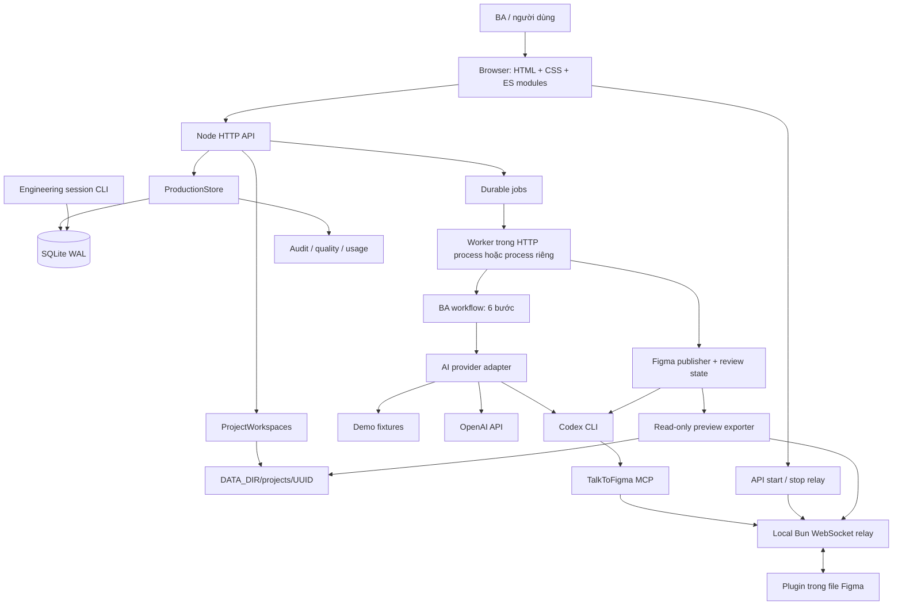

# Kiến trúc BA Studio hiện tại

Cập nhật: 15/10/2026. Mô tả triển khai trong source hiện tại, bao gồm giao diện mới đang có trong working tree. Đây là tài liệu kiến trúc hiện hành; lịch sử thay đổi source được lưu trong Git. Số phiên bản trong schema, database migration và API metadata là hợp đồng kỹ thuật, không phải bộ tài liệu kiến trúc riêng.

## 1. Mục tiêu và phạm vi

BA Studio là ứng dụng phân tích nghiệp vụ chạy local: tiếp nhận brief, chuẩn hóa yêu cầu, phát hiện thông tin thiếu, hỗ trợ làm rõ, ghi nhận BA Review, sinh tài liệu và prototype. Thiết kế Figma được thực hiện theo hành động của người dùng trong tab Prototype.

Hệ thống có một workflow điều phối tuần tự. Node.js thực thi chính sách bằng code, prompt và validation; các BA skills/UI UX Pro Max là hướng dẫn cho agent, không phải những tiến trình Superpowers chạy trong HTTP server.

Các ranh giới quan trọng:

- Bằng chứng trích dẫn nguồn không đồng nghĩa yêu cầu đã được khách hàng ký duyệt.
- BA Review, duyệt thiết kế Figma và customer sign-off là các khái niệm riêng.
- Điểm chất lượng tự động là phép kiểm tra xác định, không đo đầy đủ tính đúng nghiệp vụ.
- HTML prototype là wireframe tương tác với dữ liệu minh họa; không triển khai backend nghiệp vụ khách hàng.
- Tạo frame Figma không bảo đảm có native prototype navigation.

## 2. Sơ đồ hệ thống

## 3. Runtime và ranh giới triển khai

| Thành phần | Cách chạy | Trách nhiệm |
|---|---|---|
| Browser | `public/index.html`, native ES modules | Điều hướng, biểu mẫu, preview, polling, tải file |
| HTTP server | Node.js >=22.13, `src/server.js` | Route, auth, validation, version/lease guards, orchestration |
| Embedded worker | Mặc định bật cùng HTTP process | Nhận job từ SQLite và thực thi tuần tự trong process |
| Standalone worker | `npm run worker` | Dùng cùng implementation, không mở HTTP listener |
| SQLite | `DATA_DIR/ba-studio.sqlite`, WAL | Nguồn dữ liệu chính, lịch sử, queue, audit, telemetry, session ledger |
| Filesystem | Cùng host với database | Workspace, attachment, registry, preview, compatibility mirrors |
| Codex subprocess | Khi gọi provider hoặc chạy thiết kế | Structured output; timeout; scope MCP riêng cho Figma |
| Bun relay | Người dùng khởi chạy từ Prototype | WebSocket loopback cho MCP/plugin và export preview |

Mặc định HTTP ở `127.0.0.1:3478`, relay ở `127.0.0.1:3055`. Relay do BA Studio quản lý chạy file vendored bằng Bun (`shell:false`), không nhận command tùy ý từ người dùng. Trạng thái READY chỉ xác nhận relay lắng nghe, không chứng minh plugin đã kết nối.

Nhiều process cùng host có thể dùng chung `DATA_DIR` nhờ lease fencing. SQLite WAL không được đặt trên NFS/SMB. Không có distributed queue hoặc database cluster.

## 4. Đường đi của một thao tác

1. Browser gửi JSON và `If-Match` theo project version cho mutation của dự án.
2. Server kiểm tra token khi cần, reviewer identity tại route liên quan, UUID, version và quyền ghi dưới lease.
3. Với thao tác trực tiếp, server validate đầu vào, cập nhật project và ghi audit; với workflow/Figma, server enqueue job.
4. Worker claim job, giữ lease và heartbeat; stale writer không được commit.
5. AI output được kiểm tra schema/giới hạn và chuẩn hóa trước khi ghi trạng thái.
6. SQLite commit lưu project, snapshot/audit và quality tương ứng; JSON/files được xuất như projection.
7. Browser đọc lại project/job để render trạng thái mới. Việc hết thời gian chờ ở browser không tự chứng minh job thành công.

SQLite và filesystem không có một transaction chung. Sau lỗi I/O cần kiểm tra database và projections; không suy luận trạng thái từ một file tồn tại. `project:migrate` phục hồi exported workspace; không replay workflow đã hoàn tất.

## 5. Lưu trữ và mô hình dữ liệu

| Nhóm bảng | Nội dung |
|---|---|
| `projects`, `project_versions` | JSON trạng thái hiện tại, business version và lịch sử project |
| `project_leases` | Fencing token và thời hạn quyền ghi |
| `workflow_jobs` | Options, attempts, trạng thái queue, retry/lease/result version |
| `audit_events` | Actor, loại sự kiện, chi tiết, hash chain |
| `figma_challenges` | Nonce scoped/expiring/single-use cho read-back legacy |
| `quality_snapshots` | Kết quả kiểm tra chất lượng theo version/digest |
| `ai_invocations` | Usage/cost/latency metadata; không lưu prompt hoặc customer text |
| `project_documents` | Metadata, checksum và đường dẫn attachment thuộc UUID |
| `continuity_tasks`, `continuity_sessions`, `continuity_checkpoints` | Ledger công việc kỹ thuật của Codex/Claude |

`project.version` là phiên bản nghiệp vụ; `projects.revision` là optimistic database revision; job/run ID và engineering task version là các phạm vi độc lập. Không dùng chúng thay thế nhau.

Workspace của mỗi UUID gồm `00-admin` đến `09-archive`, chi tiết tại [Project workspaces](PROJECT_WORKSPACES.md). Tên dự án chỉ để hiển thị. File JSON cấp `DATA_DIR` là compatibility mirror; SQLite luôn là nguồn chính.

## 6. Bảo toàn yêu cầu và đầu ra

`model-output.js` validate đầu ra provider; `normalize.js` và `revisions.js` chuẩn hóa, giữ FR/NFR/BR/Q/SCR IDs và provenance. `ba-quality.js` tìm gap và bổ sung câu hỏi. `quality-intelligence.js` đánh giá bằng chứng, actor, acceptance criteria, goal mapping, document trace và NFR target.

Sau câu trả lời hoặc quyết định làm rõ, `requirementsRefreshPending` yêu cầu phân tích lại và review lại trước các đầu ra downstream. `techStack` là công nghệ đang dùng; ERP candidate là phương án đang xem xét. Fit–Gap phải có người xác nhận và bằng chứng theo version/edition.

`docs.js`, `ba-canonical.js`, `export.js` render PRD/BRD/SRS, canonical JSON, câu hỏi và HTML prototype. Workspace có thể chứa bản DRAFT ngay khi đã có analysis; API xuất tài liệu vẫn áp dụng BA Review và pending-refresh guards. File xuất hiện trong thư mục không phải bằng chứng đã phê duyệt.

## 7. An toàn và quyền

- Local loopback là cấu hình mặc định. Khi bind public, API yêu cầu bearer token và reviewer identity; vận hành sau HTTPS/VPN/reverse proxy phù hợp.
- Đặt `REQUIRE_IF_MATCH=true` khi chia sẻ API/client để tránh ghi đè stale version.
- Reviewer được nhận diện qua `X-BA-Reviewer-Token` và mapping cấu hình. Đây không phải hệ thống OIDC/RBAC/multi-tenant hoàn chỉnh.
- Input khách hàng, attachment và model output là dữ liệu không tin cậy. Không coi nội dung tài liệu là lệnh thực thi.
- Attachment/preview kiểm tra UUID, đường dẫn, symlink, kích thước và checksum; preview còn kiểm tra format/MIME.
- MCP approval cho Figma là opt-in, scope theo subprocess và danh sách tool cố định; không thay cấu hình Codex toàn cục, không cấp tool xóa node.
- Audit hash chain giúp phát hiện thay đổi nhưng không chống được database administrator có toàn quyền.

## 8. Khả năng và giới hạn hiện tại

Đã triển khai: workflow có human gates, queue bền vững, project isolation theo UUID, versioning, batch clarification, ERP candidate/Fit–Gap, quality/usage dashboard, relay local, Figma review/revision/gallery, recovery preview và session continuity.

Giới hạn: AI/tool side effects có thể xảy ra trước commit; không có exactly-once cho external calls; retry có thể tốn chi phí hoặc tạo frame dư. Không có đồng bộ hai chiều tự động với mọi chỉnh sửa trực tiếp trên Figma. Usage/pricing thiếu là UNKNOWN. Offline fixture tests không chứng nhận semantic accuracy, production acceptance, customer signoff hoặc live MCP connectivity.

Đọc tiếp: [Thành phần](COMPONENTS.md), [Workflow](WORKFLOWS.md), [API](API.md), [Vận hành](OPERATIONS.md), [Figma](figma-handoff.md).
