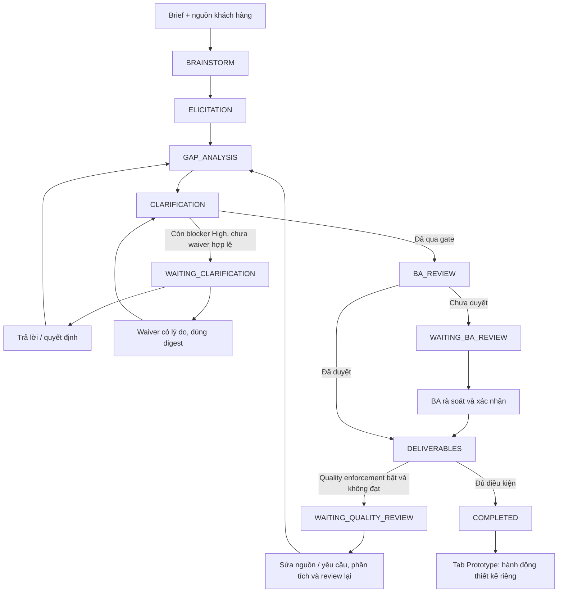
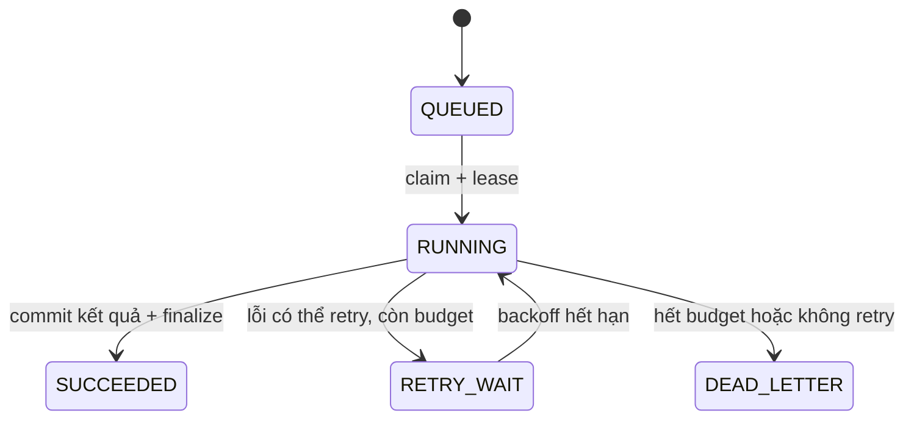
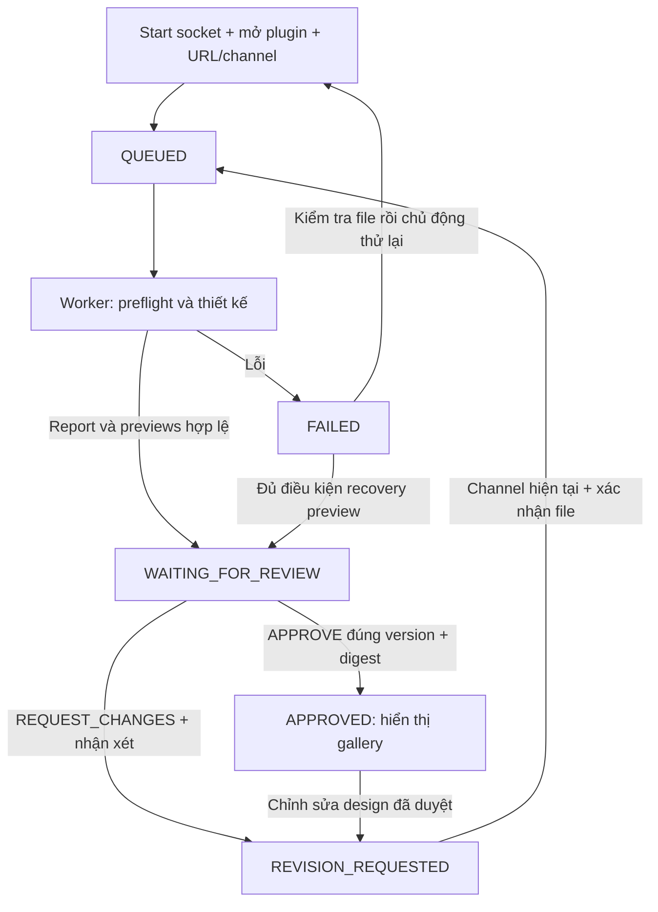

# Workflow và vòng đời dữ liệu

Source chính: `src/server.js`, `src/intelligent-workflow.js`, `src/figma-design-review.js`. Xem [Kiến trúc](ARCHITECTURE.md) để phân biệt project state, job state và engineering session.

## 1. Workflow BA hiện tại



| Stage | Công việc | Điểm dừng / kết quả |
|---|---|---|
| BRAINSTORM | Sinh cơ hội/câu hỏi/giả định DRAFT | Không ghi hypotheses thành confirmed requirements |
| ELICITATION | Trích xuất nguồn, normalize, giữ IDs | Analysis + source evidence + quality/questions |
| GAP_ANALYSIS | Refresh analysis khi pending; tính gap; gợi ý khi có references hợp lệ | Gap report và draft proposals |
| CLARIFICATION | Kiểm tra blocker High và waiver bound với analysis/blocker digest | WAITING_CLARIFICATION hoặc tiếp tục |
| BA_REVIEW | Chờ con người rà soát analysis hiện tại | WAITING_BA_REVIEW hoặc reviewer record |
| DELIVERABLES | Kiểm tra có FR, BA review, optional quality gate; sinh prototype nếu thiếu | COMPLETED; tài liệu được render/export theo guards |

UI dùng `POST /workflow/jobs` để enqueue. `POST /workflow/advance` vẫn có cho client/CLI đồng bộ; `auto:false` chạy tối đa một stage. Không bỏ qua human gates khi auto.

Sau DELIVERABLES, workflow mới không chạy `FIGMA_DESIGN`/`FIGMA_PUBLISH` và không tạo manual Design Pack panel. ID cũ vẫn tồn tại trong dữ liệu và API tương thích; mở project cũ không tự replay hoặc migrate approval.

## 2. Ghi trạng thái và queue



Mỗi stage ghi RUNNING intent/currentAttempt trước công việc; thành công ghi checkpoint, tiến stage và lưu version. Lỗi dùng lại durable snapshot, ghi FAILED và safe error. Attempt bỏ dở được đánh dấu ABANDONED khi tiếp tục. Job SUCCEEDED có thể chỉ có nghĩa đã đến một human gate, không phải toàn dự án hoàn tất.

Worker claim có fencing token, gia hạn heartbeat, kiểm tra run/project trước finalize. BA jobs mặc định có retry budget; Figma jobs chỉ một attempt và không tự retry vì remote frames có thể đã được tạo. Ghi state và external effects không exactly-once. Không dùng một lần timeout ở UI để kết luận AI hoặc Figma đã thất bại hoàn toàn.

## 3. Làm rõ yêu cầu và đề xuất

1. Người dùng nhập câu trả lời hoặc yêu cầu sinh draft options; chỉ mở form không gọi external AI.
2. Technical mode dùng actual stack/candidate references. Business mode tạo giả thuyết trả lời, không tự xác nhận công nghệ.
3. UI batch sinh theo nhóm, giữ draft theo project trong bộ nhớ. Với `selectionMode:ba-draft`, option được xếp hạng và chọn ở **draft**; người dùng vẫn phải lưu quyết định.
4. Batch save validate question IDs, exact option/digest, authority, attribution và attachments trên cùng snapshot.
5. Server ghi câu trả lời/decision + audit, làm stale các phần phụ thuộc, đặt `requirementsRefreshPending=true`.
6. Người dùng tiếp tục workflow hoặc phân tích lại; sau đó BA Review lại trước downstream exports/design.

Custom answer cần respondent attribution. Quyết định BA qua `decisionContext:ba-ui` có thể dùng internal decision-log reference thay form source/rationale; đó không phải bằng chứng khách hàng độc lập. Customer-authority flow có yêu cầu riêng về representative/evidence. [Clarification](CLARIFICATION.md) mô tả các mode và payload.

Waiver chỉ áp dụng cho đúng tập blocker và analysis digest, không biến yêu cầu thiếu chứng cứ thành xác nhận. Input thay đổi làm waiver/approval downstream mất hiệu lực theo các guards.

## 4. ERP

Cấu hình domain/profile và installed tech stack riêng. Người dùng chọn shortlist/strategy, thực hiện discovery As-Is/To-Be, ghi Fit–Gap theo requirement × platform cùng edition/version/evidence. Thay shortlist hoặc Fit–Gap làm stale proposals và review liên quan. Sinh comparison là bản DRAFT; không tự cài ERP, xác nhận module, suy diễn TCO hoặc compliance. Chi tiết [ERP](ERP.md).

## 5. Figma trong Prototype

Điều kiện: project có BA Review hiện tại, prototype screens, không pending refresh; relay READY. Người dùng mở đúng file Figma, chạy plugin, nhập URL/channel và xác nhận file.



`DESIGNING` là trạng thái trong helper/in-memory execution; bản project durable được enqueue là QUEUED cho tới khi worker commit draft hoặc lỗi. Relay có lifecycle riêng STOPPED/STARTING/READY/STOPPING/FAILED; không trộn với design state hoặc job state.

Publisher tạo handoff nội bộ theo version, preflight file/channel, gọi Codex + UI UX Pro Max + TalkToFigma, validate node report/registry và export PNG/JPEG trực tiếp qua relay. Review draft phải đủ mọi current prototype screen với đúng FR mapping và preview hợp lệ.

APPROVE ràng buộc projectVersion và manifestDigest; gallery chỉ render approved set khi state APPROVED. REQUEST_CHANGES từ bản đã duyệt cần feedback, đúng current version/digest; bản sửa phải duyệt lại. Lịch sử approval/frames được giữ, không tự delete node. Một bản cũ có thể được giữ trong history nhưng không đồng nghĩa được đưa vào gallery cho bản mới.

File identity operator confirmation chỉ thay được thiếu file key trong một plugin đã kết nối, không vượt qua mismatch, thiếu MCP hay approval denial. Operator report không phải independent attestation. Chi tiết, mã lỗi và preview recovery: [Figma handoff](figma-handoff.md).

## 6. Tài liệu bổ sung

Tab Tài liệu: chọn customer/reference/approval → chọn text file trong giới hạn → POST files → ghi file immutable và metadata/checksum → GET list/read để tải lại. File bản gốc không bị diễn giải thành instruction. Upload attachment không tự parse thành requirement hoặc gửi provider. Attachment của câu trả lời có thể là binary base64 theo giới hạn API.

Các bản DRAFT PRD/BRD/SRS/prototype sinh từ model có lifecycle riêng với supplemental documents. Download chính thức kiểm tra BA Review/pending refresh; source snapshots cũ chỉ đọc.

## 7. Engineering session continuity

```text
bootstrap → chọn NEW_TASK hoặc RESUME cụ thể
  → làm việc → checkpoint có evidence SHA
  → handoff → session tiếp theo verify/resume
  → finish khi không còn next/risks/inProgress
```

Ledger này không tự advance BA workflow hay approve dự án. Khi evidence drift, RECONCILE phải nêu lý do và cập nhật/invalidate evidence thật; không chỉnh projection để giả match. Hooks chỉ xuất trạng thái đã commit. Xem [Session continuity](SESSION_CONTINUITY.md).
